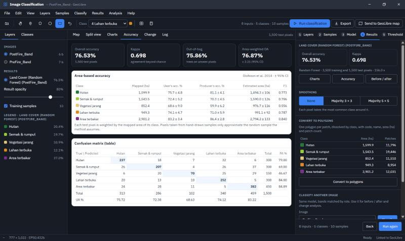
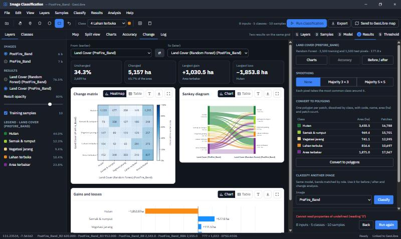
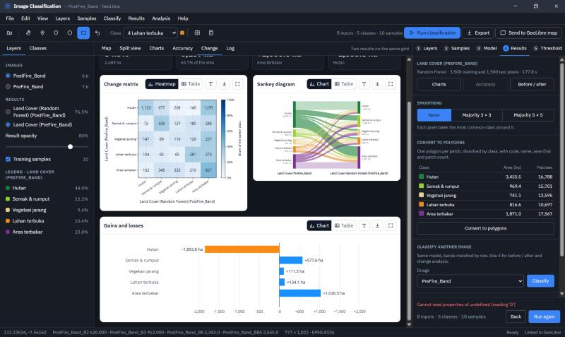
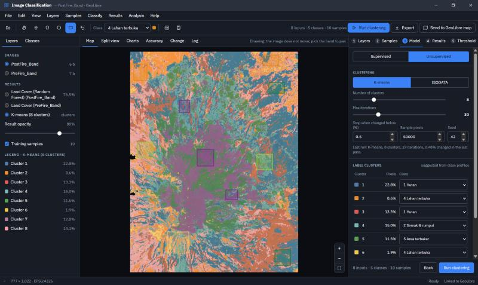

# Image Classification untuk GeoLibre

Plugin [GeoLibre](https://geolibre.app) untuk klasifikasi tutupan lahan dari citra satelit, langsung di peramban atau GeoLibre Desktop. Isinya klasifikasi terbimbing (Random Forest, Gradient Tree Boost, SVM), klasifikasi tak terbimbing (K-means, ISODATA), uji akurasi (termasuk akurasi berbasis luas Olofsson dkk. 2014), dan analisis perubahan lahan antara dua tanggal. Semua dihitung di komputer sendiri; tidak ada data yang dikirim ke server.


*Citra contoh: Sentinel-2 sebelum dan sesudah kebakaran Gunung Lawu 2023, komposit Burn scar (B11 B8 B3). Ungu = area terbakar.*

## Daftar isi

- [Fitur](#fitur)
- [Instalasi](#instalasi)
- [Tutorial](#tutorial)
- [Metode dan rumus](#metode-dan-rumus)
- [Indeks spektral](#indeks-spektral)
- [Sensor yang didukung](#sensor-yang-didukung)
- [Build dan pengujian](#build-dan-pengujian)
- [Daftar pustaka](#daftar-pustaka)
- [Lisensi](#lisensi)

## Fitur

| Bagian | Isi |
|---|---|
| Window | Jendela penuh di atas GeoLibre: title bar, menu (File, Edit, View, Layers, Samples, Classify, Results, Analysis, Help), toolbar, dock kiri (citra, hasil, legenda), dock kanan (alur kerja), status bar |
| Tab tengah | **Map · Split view · Charts · Accuracy · Change · Log** |
| Citra | Tambah folder atau file GeoTIFF. Band dikelompokkan per scene (`PreFire_Band_B2`, `PreFire_Band_B3` … → set `PreFire_Band`) |
| Tampilan | Komposit RGB (preset True colour, False colour, Burn scar, SWIR, Agriculture, atau bebas), band tunggal, indeks, ekspresi sendiri. Nama band bisa nomor (B11 B8 B3) atau nama (SWIR1 NIR Green) |
| Sampel | Titik, poligon, lingkaran, persegi (tarik atau dua klik). Geser citra hanya dengan ikon tangan. Impor dari layer vektor, simpan sebagai layer |
| Terbimbing | Random Forest, Gradient Tree Boost, SVM (RBF, linear, polinomial, sigmoid), opsi *Balance classes* |
| Tak terbimbing | K-means (inisialisasi k-means++), ISODATA (pecah, gabung, buang klaster), lalu labeli klaster menjadi kelas |
| Akurasi | Confusion matrix, OA, kappa, PA, UA, F1, OOB (RF), akurasi berbasis luas dengan galat baku |
| Grafik | Kartu putih (juga di mode gelap): confusion matrix gaya matplotlib, luas kelas, pentingnya variabel, spectral profile gaya jurnal, heatmap korelasi gaya seaborn |
| Perubahan lahan | Terapkan model ke citra tanggal lain, lalu change matrix (ha), diagram Sankey, gains/losses |
| Pasca-proses | Smoothing majority 3×3 / 5×5, konversi ke poligon (dissolve per kelas) |
| Ekspor | Langsung ke folder di komputer: GeoTIFF berpalet, GeoJSON, XLSX, CSV, grafik PNG 300 dpi dan SVG |

## Instalasi

**GeoLibre Desktop**

1. Build `image-classification-<versi>.zip` (lihat [Build](#build-dan-pengujian)), atau unduh dari [Releases](https://github.com/Defani/geolibre-image-classification/releases) bila versi itu sudah dirilis.
2. **Settings → Manage plugins → Settings → Install from file → Choose .zip…**
3. **Plugins → Installed → Image Classification**, lalu buka lewat menu **Image Classification** di bilah atas.

**GeoLibre Web (https://web.geolibre.app)**

Cara yang sama dengan *Choose .zip…*; plugin disimpan di peramban. Untuk pengembangan, tambahkan URL manifest (misalnya `http://localhost:8098/plugin/plugin.json`) di **Manifest URLs**.

## Tutorial

Contoh di bawah memakai citra Sentinel-2 Gunung Lawu 2023: tujuh band sebelum kebakaran (`PreFire_Band_B2 … B12`) dan enam band sesudahnya (`PostFire_Band_*`).

### 1. Muat citra

**File → Add folder of GeoTIFFs…** (atau *Add files…*). Plugin membaca setiap file pada resolusi aslinya dan menebak peran band dari namanya (`…_B8A.tif` → B8A). Band yang namanya sama kecuali nomor band dijadikan satu *image set*, tampil di dock kiri **Images**. Klik salah satu set untuk menjadikannya citra aktif.

Di dock kanan **1 Layers**:

- **Sensor**: pilih sensornya agar nomor band dipetakan dengan benar (Landsat 8 B5 = NIR, dst.).
- **Indices**: klik indeks yang ingin dipakai sebagai input tambahan, atau tulis ekspresi sendiri, misalnya `(B8 - B12) / (B8 + B12)`.
- **Grid**: layer acuan dan ukuran sel. Band beresolusi lain di-resample (nearest) ke grid ini.
- **RGB composite**: pilih preset. Untuk area terbakar pakai **Burn scar (B11 B8 B3)**.

### 2. Buat kelas dan sampel

Di **2 Samples**, isi nama kelas lalu **Add class**. Kode kelas otomatis 1, 2, 3 … (0 = NoData). Skema warna KLHK, MapBiomas, atau NLCD bisa dipakai lewat **Scheme**.

Pilih alat gambar di toolbar atau di **Draw samples**:

| Alat | Cara |
|---|---|
| Point | klik satu piksel |
| Polygon | klik titik-titik sudut, klik titik pertama atau klik ganda untuk menutup |
| Circle | tarik dari pusat, atau klik pusat lalu klik tepi |
| Rectangle | tarik dari satu sudut ke sudut seberang, atau klik dua sudut |

Saat alat gambar aktif, citra tidak ikut bergeser; pakai ikon tangan untuk menggeser dan roda tetikus untuk zoom. Spectral profile di bagian bawah dock diperbarui setiap kali sampel ditambah.


Tips sampel: gambar beberapa kotak kecil yang tersebar untuk setiap kelas, bukan satu kotak besar; ambil dari piksel yang jelas homogen.

### 3. Pilih model

**3 Model → Supervised**:

| Parameter | Default | Keterangan |
|---|---|---|
| Algoritme | Random Forest | RF, GTB, atau SVM |
| RF | 500 pohon, min leaf 1, bag 0,5, √d variabel per split | |
| GTB | 200 pohon, shrinkage 0,05, sampling 0,7, 5 node | |
| SVM | RBF, C = 10, γ = 0,5 | γ dibagi jumlah input setelah standardisasi |
| Split | 70 % latih / 30 % uji, per piksel atau per sampel | per sampel lebih jujur bila sampel berdekatan |
| Max pixels per sample | 500 | membatasi dominasi poligon besar |
| Balance classes | mati | bobot kelas berbanding terbalik dengan frekuensinya |
| Seed | 42 | hasil bisa diulang |

Klik **Run classification**. Hasilnya muncul di peta, di dock kiri **Results**, dan di **4 Results**: OA, kappa, luas per kelas, jumlah patch.

### 4. Periksa akurasi dan grafik

Tab **Accuracy**: OA, kappa, OOB, akurasi berbasis luas ±95 % CI, dan confusion matrix lengkap dengan PA/UA.



Tab **Charts**: setiap kartu punya tombol Grafik/Tabel, unduh (CSV, XLSX, PNG 300 dpi, SVG), dan layar penuh.


### 5. Smoothing dan poligon

Di **4 Results → Smoothing** pilih Majority 3 × 3 atau 5 × 5 (luas dan grafik ikut diperbarui; akurasi tetap dari model). **Convert to polygons** menambahkan layer GeoLibre berisi satu MultiPolygon per kelas dengan kolom `class_code`, `class_name`, `area_ha`, `patches`, `color`.

### 6. Before/after dan perubahan lahan

1. Di **4 Results → Classify another image**, pilih set lain (misalnya `PreFire_Band`) lalu **Classify**. Model yang sama diterapkan; band dicocokkan menurut perannya.
2. Tab **Split view** menampilkan dua citra atau hasil dengan swipe atau berdampingan.


3. Tab **Change**: pilih hasil awal (*From*) dan akhir (*To*); tombol ⇄ menukar keduanya. Isinya ringkasan luas tak berubah/berubah, change matrix, diagram Sankey, serta gains and losses per kelas.





Pada data contoh, sekitar 1.295 ha hutan sebelum kebakaran menjadi area terbakar; area terbakar bertambah bersih ±1.030 ha dan hutan berkurang ±1.854 ha. Angka ini berasal dari 10 kotak sampel dan hanya untuk ilustrasi.

### 7. Klasifikasi tak terbimbing

**3 Model → Unsupervised**, pilih K-means atau ISODATA, atur jumlah klaster, lalu **Run clustering**. Di **Label clusters** setiap klaster diberi kelas (plugin menyarankan kelas terdekat dari profil sampel bila ada); hasil pelabelan menjadi peta tutupan lahan baru.



### 8. Ekspor

**Export** (Ctrl+E) membuka dialog: centang isi yang diinginkan, beri awalan nama file, lalu **Choose folder and export**. Semua file ditulis langsung ke folder yang dipilih. Peramban tanpa akses folder akan mengunduh file satu per satu.

| File | Format |
|---|---|
| Raster klasifikasi | GeoTIFF Uint8 berpalet, NoData 0 |
| Poligon per kelas | GeoJSON |
| Laporan akurasi | XLSX (OA, kappa, matriks, PA/UA, akurasi berbasis luas) |
| Grafik | PNG 300 dpi + SVG |
| Sampel latih | GeoJSON |
| Perubahan lahan | XLSX (change matrix, gains/losses) |

**Send to GeoLibre map** menambahkan hasil sebagai layer COG di peta GeoLibre dan memperbesar peta ke sana.

### Pintasan keyboard

| Tombol | Aksi |
|---|---|
| `1` … `6` | Map, Split view, Charts, Accuracy, Change, Log |
| `0` | zoom ke seluruh citra |
| `P` `G` `C` `R` `H` | alat Point, Polygon, Circle, Rectangle, Pan |
| `Ctrl+Z` | batalkan sampel terakhir |
| `F5` | jalankan klasifikasi / clustering |
| `Ctrl+E` | ekspor ke folder |
| `Esc` | batalkan gambar yang belum selesai, tutup dialog |

## Metode dan rumus

### Notasi

$n$ jumlah piksel latih, $d$ jumlah input (band + indeks), $K$ jumlah kelas, $n_k$ jumlah piksel kelas $k$.

### Random Forest

Setiap pohon dilatih pada sampel bootstrap berukuran $\text{bag} \cdot n$. Pada tiap node dipilih acak $m = \mathrm{round}(\sqrt{d})$ variabel, dan split dipilih yang paling menurunkan ketidakmurnian Gini:

```math
G(t) = 1 - \sum_{k=1}^{K} p_{k}(t)^{2}, \qquad \Delta G = n_t\,G(t) - n_{L}\,G(L) - n_{R}\,G(R)
```

Prediksi adalah suara terbanyak semua pohon. Pentingnya variabel $j$ adalah jumlah $\Delta G$ pada split yang memakai $j$, dinormalkan sehingga totalnya 1. Akurasi *out-of-bag* dihitung dari pohon yang tidak memakai piksel itu dalam bootstrap-nya (Breiman, 2001).

### Gradient Tree Boost

Model aditif per kelas $F_k(x)$ dengan softmax dan multinomial deviance (Friedman, 2001):

```math
p_k(x) = \frac{e^{F_k(x)}}{\sum_{j} e^{F_j(x)}}, \qquad L = -\sum_{i=1}^{n}\sum_{k=1}^{K} y_{ik}\,\ln p_k(x_i)
```

Setiap ronde, untuk setiap kelas sebuah pohon kecil dipasang pada gradien $g_{ik} = y_{ik} - p_k(x_i)$ dengan hessian $h_{ik} = p_k(x_i)\,(1-p_k(x_i))$, lalu $F_k \leftarrow F_k + \nu\, f_k$ dengan shrinkage $\nu$ (default 0,05) dan subsampel baris (default 0,7).

### Support Vector Machine

C-SVC (Cortes & Vapnik, 1995), satu lawan satu untuk multikelas, diselesaikan dengan SMO *maximal violating pair* (Keerthi dkk., 2001). Input distandardisasi $z = (x-\mu)/\sigma$. Bentuk dual:

```math
\max_{\alpha}\; \sum_i \alpha_i - \tfrac12 \sum_{i,j} \alpha_i \alpha_j y_i y_j K(x_i, x_j) \quad \text{s.t. } 0 \le \alpha_i \le C,\; \sum_i \alpha_i y_i = 0
```

| Kernel | $K(x, x')$ |
|---|---|
| RBF | $\exp(-\gamma\,\lVert x - x' \rVert^{2})$ |
| Linear | $x^\top x'$ |
| Polinomial | $(\gamma\, x^\top x' + c_0)^{p}$ |
| Sigmoid | $\tanh(\gamma\, x^\top x' + c_0)$ |

$\gamma$ yang dimasukkan dibagi $d$. Untuk menjaga ukuran matriks kernel, SVM dilatih pada paling banyak 2.000 piksel terstratifikasi.

### Bobot kelas seimbang

Dengan *Balance classes*, bobot setiap kelas sama dengan `class_weight="balanced"` di scikit-learn (Pedregosa dkk., 2011):

```math
w_k = \frac{n}{K\, n_k}
```

RF memakai bootstrap dengan jumlah tarikan sama per kelas, GTB mengalikan gradien dan hessian dengan $w_k$, SVM memakai $C_k = w_k C$.

### Akurasi

Confusion matrix $n_{ij}$: baris $i$ = referensi, kolom $j$ = hasil klasifikasi, $n_{i+}$ dan $n_{+j}$ jumlah baris dan kolom (Congalton, 1991).

```math
\text{OA} = \frac{\sum_k n_{kk}}{n}, \qquad
\text{PA}_k = \frac{n_{kk}}{n_{k+}}, \qquad
\text{UA}_k = \frac{n_{kk}}{n_{+k}}, \qquad
F1_k = \frac{2\,n_{kk}}{n_{k+} + n_{+k}}
```

```math
\kappa = \frac{p_o - p_e}{1 - p_e}, \qquad p_o = \text{OA}, \qquad p_e = \frac{\sum_k n_{k+}\, n_{+k}}{n^{2}}
```

(Cohen, 1960)

### Akurasi berbasis luas

Mengikuti Olofsson dkk. (2014), cara yang juga dipakai Semi-Automatic Classification Plugin (Congedo, 2021). $W_i$ adalah proporsi luas kelas peta $i$ dan $n_{i\cdot}$ jumlah piksel uji yang dipetakan sebagai $i$:

```math
\hat p_{ij} = W_i \,\frac{n_{ij}}{n_{i\cdot}}, \qquad
\widehat{\text{OA}} = \sum_j \hat p_{jj}, \qquad
\widehat{\text{UA}}_i = \frac{n_{ii}}{n_{i\cdot}}, \qquad
\widehat{\text{PA}}_j = \frac{\hat p_{jj}}{\sum_i \hat p_{ij}}, \qquad
\hat A_j = A_{\text{total}} \sum_i \hat p_{ij}
```

```math
\mathrm{SE}(\widehat{\text{OA}}) = \sqrt{\sum_i W_i^{2}\,\frac{\widehat{\text{UA}}_i\,(1-\widehat{\text{UA}}_i)}{n_{i\cdot}-1}}, \qquad \text{CI}_{95\%} = \pm \text{1,96}\, \mathrm{SE}
```

Di sini indeks $i$ = kelas peta dan $j$ = kelas referensi. Karena piksel uji berasal dari sampel yang digambar tangan, bukan sampel acak, angka ini hanya pendekatan.

### Luas piksel

Pada grid geografis (EPSG:4326) luas sel dihitung per baris lintang:

```math
A_{\text{sel}} = R^{2}\,\Delta\lambda\,\lvert \sin\varphi_{1} - \sin\varphi_{2} \rvert, \qquad R = \text{6 371 008,8 m}
```

Pada grid terproyeksi $A_{\text{sel}} = \lvert\Delta x\,\Delta y\rvert$.

### K-means

Meminimalkan jumlah kuadrat jarak dalam klaster (Lloyd, 1982):

```math
J = \sum_{k=1}^{K} \sum_{x \in C_k} \lVert x - \mu_k \rVert^{2}
```

Pusat awal dengan k-means++ (Arthur & Vassilvitskii, 2007): pusat berikutnya dipilih dengan peluang sebanding $D(x)^{2}$, jarak kuadrat ke pusat terdekat yang sudah ada. Iterasi berhenti setelah *Max iterations* atau bila bagian piksel yang berpindah klaster di bawah ambang. Input distandardisasi lebih dulu; klaster dihitung pada sampel piksel acak (default 50.000), lalu setiap piksel citra diberi pusat terdekat.

### ISODATA

K-means dalam beberapa ronde (Ball & Hall, 1965). Setelah setiap ronde:

- klaster dengan anggota < `minSize` dibuang;
- klaster dengan simpangan baku $\sigma_{kj}$ > `maxStd` pada suatu input dipecah dua sepanjang input itu (sampai `maxK`);
- dua pusat dengan $\lVert \mu_a - \mu_b \rVert$ < `minDist` digabung (sampai `minK`).

`maxStd` dan `minDist` dalam satuan simpangan baku karena input distandardisasi.

### Korelasi antar-input

Koefisien Pearson pada 30.000 piksel acak:

```math
r_{ab} = \frac{\sum_i (a_i-\bar a)(b_i-\bar b)}{\sqrt{\sum_i (a_i-\bar a)^{2}}\,\sqrt{\sum_i (b_i-\bar b)^{2}}}
```

Pasangan dengan $\lvert r \rvert$ mendekati 1 membawa informasi yang hampir sama.

### Perubahan lahan

Untuk hasil awal $A$ dan akhir $B$ pada grid yang sama:

```math
T_{ij} = \sum_{p} A_{\text{sel}}(p)\;[A(p) = i]\,[B(p) = j]
```

```math
\text{gain}_j = \sum_{i \ne j} T_{ij}, \qquad \text{loss}_i = \sum_{j \ne i} T_{ij}, \qquad \text{net}_k = \text{gain}_k - \text{loss}_k
```

Diagram Sankey menggambar setiap $T_{ij}$ sebagai pita dengan lebar sebanding luasnya.

### Smoothing

Filter mayoritas: setiap piksel mengambil kelas yang paling sering muncul di jendela 3 × 3 atau 5 × 5. Piksel NoData tetap NoData dan tidak ikut memilih.

## Indeks spektral

Rumus memakai reflektans (0–1) dengan nama band Sentinel-2; sensor lain dipetakan lewat peran band. Daftar indeks dan rumusnya mengikuti GEEDEF Land Cover Classification Tools.

| Indeks | Rumus | Sumber |
|---|---|---|
| NDVI | $(B8-B4)/(B8+B4)$ | Rouse dkk. (1974) |
| EVI2 | $\text{2,5}\,(B8-B4)/(B8+\text{2,4}\,B4+1)$ | Jiang dkk. (2008) |
| SAVI | $\text{1,5}\,(B8-B4)/(B8+B4+\text{0,5})$ | Huete (1988) |
| GCVI | $B8/B3 - 1$ | Gitelson dkk. (2003) |
| NDWI | $(B8-B11)/(B8+B11)$ | Gao (1996) |
| NDMI | $(B8-B11)/(B8+B11)$ | Gao (1996) |
| MNDWI | $(B3-B11)/(B3+B11)$ | Xu (2006) |
| NDBI | $(B11-B8)/(B11+B8)$ | Zha dkk. (2003) |
| NBR | $(B8-B12)/(B8+B12)$ | Key & Benson (2006) |
| NDRE | $(B8A-B5)/(B8A+B5)$ | Barnes dkk. (2000) |
| IRECI | $(B7-B4)/(B5/B6)$ | Frampton dkk. (2013) |
| PRI | $(B2-B3)/(B2+B3)$ | Gamon dkk. (1992), versi band lebar |
| CAI | $B12/B11$ | GEEDEF |
| HALL_COVER | $-\text{0,017}\,B4 - \text{0,007}\,B8 - \text{0,079}\,B12 + \text{5,22}$ | GEEDEF |
| MVI | $(B8-B3)/(B11-B3)$ | Baloloy dkk. (2020) |
| GVS | $100\,\text{NDVI} / (100\,\lvert\text{NDVI}\rvert + 100\,\lvert\text{NBR}\rvert + 1)$ | GEEDEF |
| NDFI | $(\text{GVS}-\text{NPV})/(\text{GVS}+\text{NPV})$, $\text{NPV} = 1-\text{NDVI}$ | GEEDEF, mengikuti gagasan Souza dkk. (2005) |

Ekspresi sendiri boleh memakai `B2 … B12`, `B8A`, angka, `+ - * /`, dan kurung, misalnya `(B8 - B4) / (B8 + B4 + 0.5) * 1.5`.

## Sensor yang didukung

| Sensor | Contoh peta band ke peran |
|---|---|
| Sentinel-2 MSI | B2 … B12, B8A |
| Landsat 8/9 OLI | B2→Blue, B3→Green, B4→Red, B5→NIR, B6→SWIR1, B7→SWIR2 |
| Landsat 5/7 TM, ETM+ | B1→Blue, B2→Green, B3→Red, B4→NIR, B5→SWIR1, B7→SWIR2 |
| PlanetScope SuperDove | B2→Blue, B4→Green, B6→Red, B7→Red edge, B8→NIR |
| WorldView-2/3 | B2→Blue, B3→Green, B5→Red, B6→Red edge, B7→NIR1, B8→NIR2 |
| SPOT 6/7, Pléiades | B0→Blue, B1→Green, B2→Red, B3→NIR |
| MODIS surface reflectance | B1→Red, B2→NIR, B3→Blue, B4→Green, B6→SWIR1, B7→SWIR2 |
| Lainnya | peran diatur manual |

## Build dan pengujian

Butuh Node.js dan checkout [GeoLibre](https://github.com/Defani/GeoLibre) (esbuild dipinjam dari sana; atur `GEOLIBRE_REPO` bila lokasinya lain).

```bash
node build.mjs                      # plugin/ dan image-classification-<versi>.zip
node test/unsup.mjs                 # K-means, ISODATA, korelasi, change matrix
node test/post.mjs                  # smoothing dan poligonisasi
node test/weda.mjs <stack.json> <stack.u16> <folder sampel> <out.tif>   # inti pada stack Sentinel-2 nyata
python tools/serve.py 8098 . <folder band> <folder sampel>              # CORS + byte range untuk web.geolibre.app
```

Hasil RF/GTB/SVM sudah dibandingkan dengan scikit-learn pada data yang sama: SVM identik, RF dan GTB berselisih ≤ 0,5 poin OA. Akurasi berbasis luas dicek dengan contoh numerik di Olofsson dkk. (2014).

Struktur kode:

| File | Isi |
|---|---|
| `src/core.js` | indeks, sampling, RF, GTB, SVM, akurasi, K-means, ISODATA, statistik, penulis GeoTIFF/XLSX/PNG, poligonisasi (tanpa DOM) |
| `src/main.js` | status plugin, dock alur kerja, pembacaan raster lewat API GeoLibre |
| `src/win.js` | jendela penuh, viewer kanvas, grafik SVG, analisis perubahan, ekspor |
| `src/style.css` | gaya |

## Daftar pustaka

- Arthur, D., & Vassilvitskii, S. (2007). k-means++: The advantages of careful seeding. *Proceedings of the 18th Annual ACM-SIAM Symposium on Discrete Algorithms*, 1027–1035.
- Ball, G. H., & Hall, D. J. (1965). *ISODATA, a novel method of data analysis and pattern classification*. Stanford Research Institute, Menlo Park, CA.
- Baloloy, A. B., Blanco, A. C., Sta. Ana, R. R. C., & Nadaoka, K. (2020). Development and application of a new mangrove vegetation index (MVI) for rapid and accurate mangrove mapping. *ISPRS Journal of Photogrammetry and Remote Sensing, 166*, 95–117. https://doi.org/10.1016/j.isprsjprs.2020.06.001
- Barnes, E. M., Clarke, T. R., Richards, S. E., Colaizzi, P. D., Haberland, J., Kostrzewski, M., … Moran, M. S. (2000). Coincident detection of crop water stress, nitrogen status and canopy density using ground based multispectral data. *Proceedings of the 5th International Conference on Precision Agriculture*, Bloomington, MN.
- Breiman, L. (2001). Random forests. *Machine Learning, 45*(1), 5–32. https://doi.org/10.1023/A:1010933404324
- Cohen, J. (1960). A coefficient of agreement for nominal scales. *Educational and Psychological Measurement, 20*(1), 37–46. https://doi.org/10.1177/001316446002000104
- Congalton, R. G. (1991). A review of assessing the accuracy of classifications of remotely sensed data. *Remote Sensing of Environment, 37*(1), 35–46. https://doi.org/10.1016/0034-4257(91)90048-B
- Congedo, L. (2021). Semi-Automatic Classification Plugin: A Python tool for the download and processing of remote sensing images in QGIS. *Journal of Open Source Software, 6*(64), 3172. https://doi.org/10.21105/joss.03172
- Cortes, C., & Vapnik, V. (1995). Support-vector networks. *Machine Learning, 20*(3), 273–297. https://doi.org/10.1007/BF00994018
- Frampton, W. J., Dash, J., Watmough, G., & Milton, E. J. (2013). Evaluating the capabilities of Sentinel-2 for quantitative estimation of biophysical variables in vegetation. *ISPRS Journal of Photogrammetry and Remote Sensing, 82*, 83–92. https://doi.org/10.1016/j.isprsjprs.2013.04.007
- Friedman, J. H. (2001). Greedy function approximation: A gradient boosting machine. *The Annals of Statistics, 29*(5), 1189–1232. https://doi.org/10.1214/aos/1013203451
- Gamon, J. A., Peñuelas, J., & Field, C. B. (1992). A narrow-waveband spectral index that tracks diurnal changes in photosynthetic efficiency. *Remote Sensing of Environment, 41*(1), 35–44. https://doi.org/10.1016/0034-4257(92)90059-S
- Gao, B.-C. (1996). NDWI—A normalized difference water index for remote sensing of vegetation liquid water from space. *Remote Sensing of Environment, 58*(3), 257–266. https://doi.org/10.1016/S0034-4257(96)00067-3
- Gitelson, A. A., Viña, A., Arkebauer, T. J., Rundquist, D. C., Keydan, G., & Leavitt, B. (2003). Remote estimation of leaf area index and green leaf biomass in maize canopies. *Geophysical Research Letters, 30*(5), 1248. https://doi.org/10.1029/2002GL016450
- Huete, A. R. (1988). A soil-adjusted vegetation index (SAVI). *Remote Sensing of Environment, 25*(3), 295–309. https://doi.org/10.1016/0034-4257(88)90106-X
- Jiang, Z., Huete, A. R., Didan, K., & Miura, T. (2008). Development of a two-band enhanced vegetation index without a blue band. *Remote Sensing of Environment, 112*(10), 3833–3845. https://doi.org/10.1016/j.rse.2008.06.006
- Keerthi, S. S., Shevade, S. K., Bhattacharyya, C., & Murthy, K. R. K. (2001). Improvements to Platt's SMO algorithm for SVM classifier design. *Neural Computation, 13*(3), 637–649. https://doi.org/10.1162/089976601300014493
- Key, C. H., & Benson, N. C. (2006). Landscape assessment (LA): Sampling and analysis methods. Dalam D. C. Lutes dkk. (Ed.), *FIREMON: Fire effects monitoring and inventory system* (Gen. Tech. Rep. RMRS-GTR-164-CD). USDA Forest Service, Rocky Mountain Research Station.
- Lloyd, S. P. (1982). Least squares quantization in PCM. *IEEE Transactions on Information Theory, 28*(2), 129–137. https://doi.org/10.1109/TIT.1982.1056489
- Olofsson, P., Foody, G. M., Herold, M., Stehman, S. V., Woodcock, C. E., & Wulder, M. A. (2014). Good practices for estimating area and assessing accuracy of land change. *Remote Sensing of Environment, 148*, 42–57. https://doi.org/10.1016/j.rse.2014.02.015
- Pedregosa, F., Varoquaux, G., Gramfort, A., Michel, V., Thirion, B., Grisel, O., … Duchesnay, É. (2011). Scikit-learn: Machine learning in Python. *Journal of Machine Learning Research, 12*, 2825–2830.
- Rouse, J. W., Haas, R. H., Schell, J. A., & Deering, D. W. (1974). Monitoring vegetation systems in the Great Plains with ERTS. *Third Earth Resources Technology Satellite-1 Symposium* (NASA SP-351), 309–317.
- Souza, C. M., Roberts, D. A., & Cochrane, M. A. (2005). Combining spectral and spatial information to map canopy damage from selective logging and forest fires. *Remote Sensing of Environment, 98*(2–3), 329–343. https://doi.org/10.1016/j.rse.2005.07.013
- Xu, H. (2006). Modification of normalised difference water index (NDWI) to enhance open water features in remotely sensed imagery. *International Journal of Remote Sensing, 27*(14), 3025–3033. https://doi.org/10.1080/01431160600589179
- Zha, Y., Gao, J., & Ni, S. (2003). Use of normalized difference built-up index in automatically mapping urban areas from TM imagery. *International Journal of Remote Sensing, 24*(3), 583–594. https://doi.org/10.1080/01431160304987

Perangkat dan inspirasi:

- GEEDEF Land Cover Classification Tools (Google Earth Engine) — sumber default parameter dan rumus indeks: https://github.com/Defani/GEEDEF-Land-Cover-Classification-Tools
- Semi-Automatic Classification Plugin (QGIS) — akurasi berbasis luas dan bobot seimbang: https://github.com/semiautomaticgit/SemiAutomaticClassificationPlugin
- Data contoh kebakaran Gunung Lawu 2023: https://github.com/Defani/NBR-Karhutla-Gunung-Lawu-GEE

## Lisensi

MIT © Defani Arman Alfitriansyah. Lihat [LICENSE](LICENSE).
