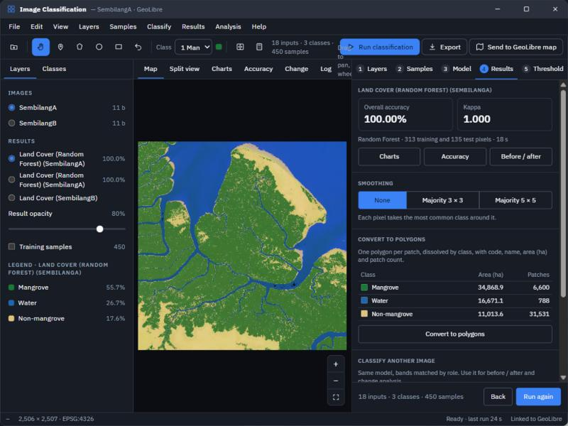
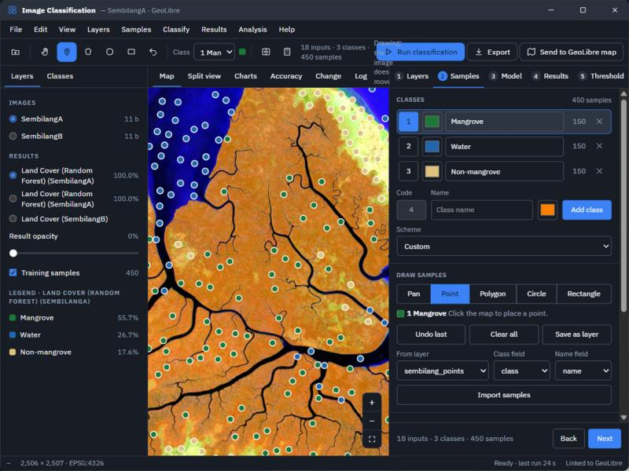
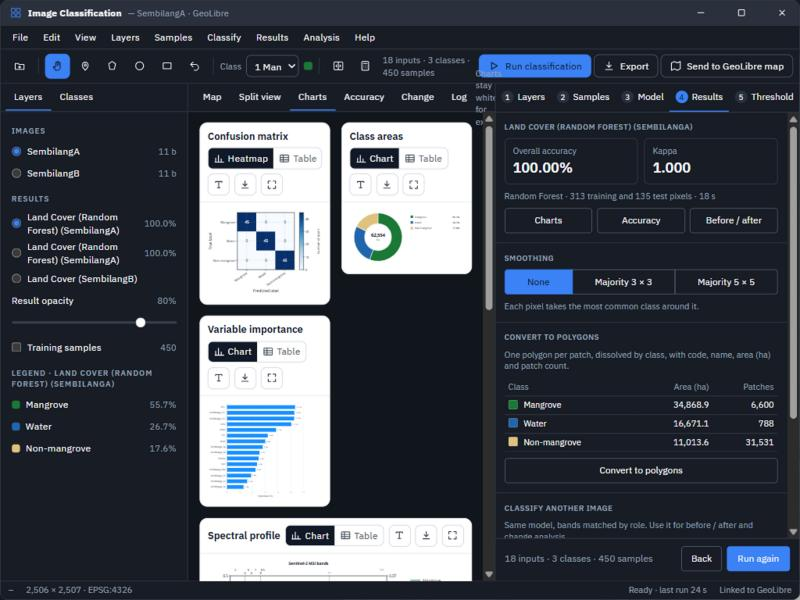
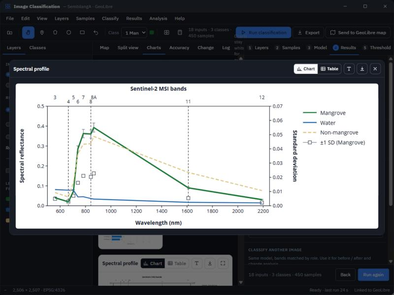
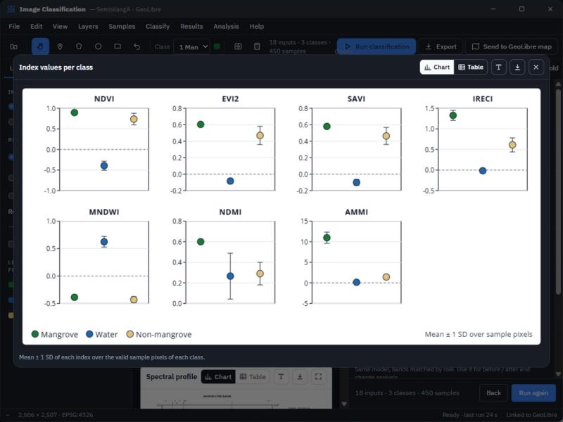
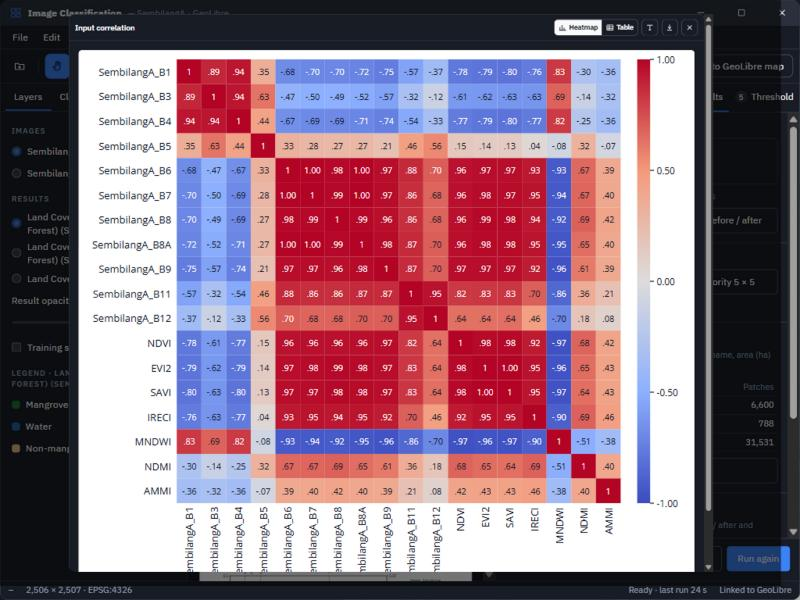
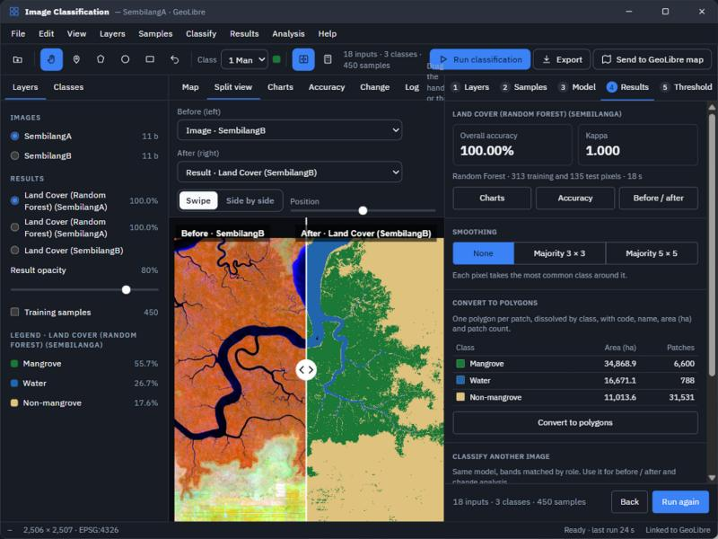
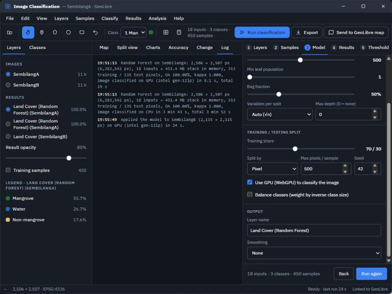

# Image Classification for GeoLibre

**English** · [Bahasa Indonesia](README.id.md)

A [GeoLibre](https://geolibre.app) plugin for land cover classification of satellite imagery, in the browser or in GeoLibre Desktop. It covers supervised classification (Random Forest, Gradient Tree Boost, SVM), unsupervised classification (K-means, ISODATA), accuracy assessment (including the area-based estimator of Olofsson et al. 2014), and land cover change between two dates. Everything runs on your own computer; no data is sent to a server.



*Example: Sentinel-2 of the Sembilang mangrove coast (South Sumatra, Indonesia), 2,506 × 2,507 px at 10 m, 11 bands + 7 indices, 450 point samples, Random Forest 500 trees. Green = mangrove, blue = water, sand = non-mangrove. The image was classified on the GPU in 9 s.*

## Contents

- [Features](#features)
- [Installation](#installation)
- [Tutorial](#tutorial)
- [Methods and formulas](#methods-and-formulas)
- [Spectral indices](#spectral-indices)
- [Supported sensors](#supported-sensors)
- [Build and tests](#build-and-tests)
- [References](#references)
- [License](#license)

## Features

| Part | What it does |
|---|---|
| Window | Full window over GeoLibre: title bar, menus (File, Edit, View, Layers, Samples, Classify, Results, Analysis, Help), toolbar, left dock (images, results, legend), right dock (workflow), status bar |
| Centre tabs | **Map · Split view · Charts · Accuracy · Change · Log** |
| Images | Add a folder or GeoTIFF files. Bands are grouped per scene (`PreFire_Band_B2`, `PreFire_Band_B3` … → set `PreFire_Band`) |
| Display | RGB composite (True colour, False colour, Burn scar, SWIR, Agriculture presets, or any bands), single band, index, your own expression. Band labels by number (B11 B8 B3) or name (SWIR1 NIR Green) |
| Samples | Point, polygon, circle, rectangle (drag or two clicks). The image pans only with the hand tool. Import from a vector layer, save as a layer |
| Supervised | Random Forest, Gradient Tree Boost, SVM (RBF, linear, polynomial, sigmoid), optional *Balance classes* |
| GPU | The image is classified on the graphics card through WebGPU (RF, GTB, SVM), with the same labels as the CPU; falls back to the CPU where WebGPU is missing |
| Unsupervised | K-means (k-means++ seeding), ISODATA (split, merge, drop clusters), then label clusters as classes |
| Accuracy | Confusion matrix, OA, kappa, PA, UA, F1, OOB (RF), area-based accuracy with standard errors |
| Charts | White cards (also in dark mode): matplotlib-style confusion matrix, class areas, variable importance, journal-style spectral profile, index values per class (mean ± SD), seaborn-style correlation heatmap |
| Land cover change | Apply the model to an image from another date, then change matrix (ha), Sankey diagram, gains and losses |
| Post-processing | Majority smoothing 3×3 / 5×5, conversion to polygons (dissolved per class) |
| Export | Straight to a folder on your computer: paletted GeoTIFF, GeoJSON, XLSX, CSV, charts as 300 dpi PNG and SVG |

## Installation

**GeoLibre Desktop**

1. Build `image-classification-<version>.zip` (see [Build](#build-and-tests)), or download it from [Releases](https://github.com/Defani/geolibre-image-classification/releases) once that version is released.
2. **Settings → Manage plugins → Settings → Install from file → Choose .zip…**
3. **Plugins → Installed → Image Classification**, then open it from the **Image Classification** menu in the top bar.

**GeoLibre Web (https://web.geolibre.app)**

Same steps with *Choose .zip…*; the plugin is stored in the browser. For development, add a manifest URL (for example `http://localhost:8098/plugin/plugin.json`) under **Manifest URLs**.

## Tutorial

Steps 1–5 use Sentinel-2 imagery of the Sembilang mangrove coast in South Sumatra: eleven bands (`SembilangA_B1 … B12`, no B2), a B8 B11 B3 composite (mangrove shows dark orange, water blue, other land pale), three classes (Mangrove, Water, Non-mangrove) and 450 point samples. A second crop, `SembilangB`, is used to apply the model to another image. The land cover change and K-means examples use Sentinel-2 before and after the 2023 fire on Mount Lawu (`PreFire_Band_*`, `PostFire_Band_*`), since change needs two dates of one place.

### 1. Load the imagery

**File → Add folder of GeoTIFFs…** (or *Add files…*). The plugin reads each file at its native resolution and guesses the band role from the name (`…_B8A.tif` → B8A). Bands whose names differ only in the band number form one *image set*, listed in the left dock under **Images**. Click a set to make it the active image.

In the right dock, **1 Layers**:

- **Sensor**: pick the sensor so band numbers map correctly (Landsat 8 B5 = NIR, and so on).
- **Indices**: click the indices to use as extra inputs, or write your own expression, for example `(B8 - B12) / (B8 + B12)`.
- **Grid**: reference layer and cell size. Bands at other resolutions are resampled (nearest) onto this grid.
- **Reflectance scale**: Auto picks 0–1, × 0.0001 (Sentinel-2 DN) or Landsat Collection 2 Level-2 (× 0.0000275 − 0.2) and shows its choice; set it by hand if the guess is wrong. Indices and spectral profiles use the scaled values.
- **RGB composite**: pick a preset. For burned areas use **Burn scar (B11 B8 B3)**.

### 2. Create classes and samples

In **2 Samples**, type a class name and press **Add class**. Class codes are assigned automatically: 1, 2, 3 … (0 = NoData). KLHK, MapBiomas or NLCD colour schemes are available under **Scheme**.

Pick a drawing tool on the toolbar or under **Draw samples**:

| Tool | How |
|---|---|
| Point | click one pixel |
| Polygon | click the vertices; click the first vertex or double-click to close |
| Circle | drag from the centre, or click the centre and then the edge |
| Rectangle | drag from one corner to the opposite one, or click two corners |

While a drawing tool is on, the image does not move; use the hand tool to pan and the mouse wheel to zoom. The spectral profile at the bottom of the dock updates with every new sample.



Tip: draw several small, spread-out boxes per class rather than one large box, over clearly homogeneous pixels.

### 3. Choose a model

**3 Model → Supervised**:

| Parameter | Default | Note |
|---|---|---|
| Algorithm | Random Forest | RF, GTB or SVM |
| RF | 500 trees, min leaf 1, bag 0.5, √d variables per split | |
| GTB | 200 trees, shrinkage 0.05, sampling 0.7, 5 nodes | |
| SVM | RBF, C = 10, γ = 0.5 | γ is divided by the number of inputs after standardising |
| Split | 70 % training / 30 % testing, by pixel or by sample | by sample is more honest when samples are close together |
| Max pixels per sample | 500 | keeps large polygons from dominating |
| Balance classes | off | class weights inversely proportional to class frequency |
| Seed | 42 | runs are repeatable |
| Use GPU | on | classifies the image's pixels with WebGPU; training stays on the CPU |

Press **Run classification**. The result appears on the map, in the left dock under **Results**, and in **4 Results**: OA, kappa, area per class, number of patches.

### 4. Check accuracy and charts

**Accuracy** tab: OA, kappa, OOB, area-based accuracy with 95 % CI, and the full confusion matrix with PA/UA.


**Charts** tab: every card has a Chart/Table switch, downloads (CSV, XLSX, 300 dpi PNG, SVG) and full screen. **Index values per class** gives the mean ± 1 SD of every selected index over the sample pixels of each class, one panel per index.









### 5. Smoothing and polygons

In **4 Results → Smoothing** choose Majority 3 × 3 or 5 × 5 (areas and charts update; accuracy stays that of the model). **Convert to polygons** adds a GeoLibre layer with one MultiPolygon per class and the fields `class_code`, `class_name`, `area_ha`, `patches`, `color`.

### 6. Before/after and land cover change

1. In **4 Results → Classify another image**, pick another set (for example `SembilangB`, or `PreFire_Band` in the fire example) and press **Classify**. The same model is applied; bands are matched by role.
2. The **Split view** tab shows two images or results with a swipe or side by side.



3. **Change** tab: choose the earlier result (*From*) and the later one (*To*); the ⇄ button swaps them. It shows unchanged/changed area, the change matrix, a Sankey diagram, and gains and losses per class.


In the example, about 1,295 ha of pre-fire forest became burned area; burned area grew by about 1,030 ha net and forest shrank by about 1,854 ha. These figures come from 10 sample boxes and are for illustration only.

### 7. Unsupervised classification

**3 Model → Unsupervised**, choose K-means or ISODATA, set the number of clusters, then **Run clustering**. Under **Label clusters** give each cluster a class (the plugin suggests the nearest class from the sample profiles when there are samples); the labelled clusters become a new land cover map.


### 8. Export

**Export** (Ctrl+E) opens a dialog: tick what you need, set a file name prefix, then **Choose folder and export**. All files are written straight into the chosen folder. Browsers without folder access download the files one by one.

| File | Format |
|---|---|
| Classified raster | Uint8 paletted GeoTIFF, NoData 0 |
| Polygons per class | GeoJSON |
| Accuracy report | XLSX (OA, kappa, matrix, PA/UA, area-based accuracy) |
| Charts | 300 dpi PNG + SVG |
| Training samples | GeoJSON |
| Land cover change | XLSX (change matrix, gains/losses) |

**Send to GeoLibre map** adds the result as a COG layer on the GeoLibre map and zooms to it.

### Keyboard shortcuts

| Key | Action |
|---|---|
| `1` … `6` | Map, Split view, Charts, Accuracy, Change, Log |
| `0` | zoom to the whole image |
| `P` `G` `C` `R` `H` | Point, Polygon, Circle, Rectangle, Pan tools |
| `Ctrl+Z` | undo the last sample |
| `F5` | run classification / clustering |
| `Ctrl+E` | export to a folder |
| `Esc` | cancel an unfinished shape, close a dialog |

### Speed and the GPU

Training uses only the sample pixels and stays on the CPU. Predicting every pixel of the image is the slow part, and each pixel is independent, so with **Use GPU** on (3 Model) it runs as a WebGPU compute shader: one shader walks the RF or GTB trees, another evaluates the one-vs-one SVM. The labels are the same as on the CPU. The **Log** tab records the grid size, pixel count, in-memory stack size, which device classified the image and how long it took.



Measured in web.geolibre.app on a laptop with Intel Iris Xe graphics:

| Test | GPU | CPU |
|---|---|---|
| 1,000,000 pixels × 18 inputs, RF 500 trees | 1.1 s | 24.8 s |
| Sentinel-2 Sembilang, 2,506 × 2,507 px (6.28 M px), 11 bands + 7 indices (431 MB), RF 500 trees: classifying the image | 9.1 s | 3 min 43 s |
| Same model applied to a second image of 2,115 × 2,115 px (whole step, reading the bands included) | 24 s | 47 s |

WebGPU is in Chrome and Edge; GeoLibre Desktop on Windows runs on WebView2, which has it too (not tested with this plugin yet). Where it is missing, or a GPU call fails part-way, the plugin finishes on the CPU and the log says so.

## Methods and formulas

### Notation

$`n`$ number of training pixels, $`d`$ number of inputs (bands + indices), $`K`$ number of classes, $`n_k`$ number of pixels of class $`k`$.

### Random Forest

Each tree is trained on a bootstrap sample of size $`\text{bag} \cdot n`$. At each node $`m = \mathrm{round}(\sqrt{d})`$ variables are drawn at random, and the split that most reduces Gini impurity is chosen:

```math
G(t) = 1 - \sum_{k=1}^{K} p_{k}(t)^{2}, \qquad \Delta G = n_t\,G(t) - n_{L}\,G(L) - n_{R}\,G(R)
```

The prediction is the majority vote of all trees. The importance of variable $`j`$ is the sum of $`\Delta G`$ over the splits on $`j`$, normalised to sum to 1. *Out-of-bag* accuracy uses, for each pixel, only the trees that did not draw it in their bootstrap (Breiman, 2001).

### Gradient Tree Boost

An additive model per class $`F_k(x)`$ with softmax and multinomial deviance (Friedman, 2001):

```math
p_k(x) = \frac{e^{F_k(x)}}{\sum_{j} e^{F_j(x)}}, \qquad L = -\sum_{i=1}^{n}\sum_{k=1}^{K} y_{ik}\,\ln p_k(x_i)
```

In every round, for every class, a small tree is fitted to the gradient $`g_{ik} = y_{ik} - p_k(x_i)`$ with hessian $`h_{ik} = p_k(x_i)\,(1-p_k(x_i))`$, then $`F_k \leftarrow F_k + \nu\, f_k`$ with shrinkage $`\nu`$ (default 0.05) and row subsampling (default 0.7).

### Support Vector Machine

C-SVC (Cortes & Vapnik, 1995), one-vs-one for multiple classes, solved with maximal-violating-pair SMO (Keerthi et al., 2001). Inputs are standardised, $`z = (x-\mu)/\sigma`$. The dual problem:

```math
\max_{\alpha}\; \sum_i \alpha_i - \tfrac12 \sum_{i,j} \alpha_i \alpha_j y_i y_j K(x_i, x_j) \quad \text{s.t. } 0 \le \alpha_i \le C,\; \sum_i \alpha_i y_i = 0
```

| Kernel | $`K(x, x')`$ |
|---|---|
| RBF | $`\exp(-\gamma\,\lVert x - x' \rVert^{2})`$ |
| Linear | $`x^\top x'`$ |
| Polynomial | $`(\gamma\, x^\top x' + c_0)^{p}`$ |
| Sigmoid | $`\tanh(\gamma\, x^\top x' + c_0)`$ |

The $`\gamma`$ you enter is divided by $`d`$. To keep the kernel matrix small, the SVM is trained on at most 2,000 stratified pixels.

### Balanced class weights

With *Balance classes* each class gets the same weight as scikit-learn's `class_weight="balanced"` (Pedregosa et al., 2011):

```math
w_k = \frac{n}{K\, n_k}
```

RF draws the bootstrap with equal numbers per class, GTB multiplies gradient and hessian by $`w_k`$, SVM uses $`C_k = w_k C`$.

### Accuracy

Confusion matrix $`n_{ij}`$: row $`i`$ = reference, column $`j`$ = classified; $`n_{i+}`$ and $`n_{+j}`$ are row and column totals (Congalton, 1991).

```math
\text{OA} = \frac{\sum_k n_{kk}}{n}, \qquad
\text{PA}_k = \frac{n_{kk}}{n_{k+}}, \qquad
\text{UA}_k = \frac{n_{kk}}{n_{+k}}, \qquad
F1_k = \frac{2\,n_{kk}}{n_{k+} + n_{+k}}
```

```math
\kappa = \frac{p_o - p_e}{1 - p_e}, \qquad p_o = \text{OA}, \qquad p_e = \frac{\sum_k n_{k+}\, n_{+k}}{n^{2}}
```

(Cohen, 1960)

### Area-based accuracy

Following Olofsson et al. (2014), the estimator the Semi-Automatic Classification Plugin also reports (Congedo, 2021). $`W_i`$ is the mapped area proportion of class $`i`$ and $`n_{i\cdot}`$ the number of test pixels mapped as $`i`$:

```math
\hat p_{ij} = W_i \,\frac{n_{ij}}{n_{i\cdot}}, \qquad
\widehat{\text{OA}} = \sum_j \hat p_{jj}, \qquad
\widehat{\text{UA}}_i = \frac{n_{ii}}{n_{i\cdot}}, \qquad
\widehat{\text{PA}}_j = \frac{\hat p_{jj}}{\sum_i \hat p_{ij}}, \qquad
\hat A_j = A_{\text{total}} \sum_i \hat p_{ij}
```

```math
\mathrm{SE}(\widehat{\text{OA}}) = \sqrt{\sum_i W_i^{2}\,\frac{\widehat{\text{UA}}_i\,(1-\widehat{\text{UA}}_i)}{n_{i\cdot}-1}}, \qquad \text{CI}_{95\%} = \pm 1.96\, \mathrm{SE}
```

Here $`i`$ is the map class and $`j`$ the reference class. Because the test pixels come from hand-drawn samples rather than a random sample, these figures are only an approximation.

### Pixel area

On a geographic grid (EPSG:4326) the cell area is computed per row of latitude:

```math
A_{\text{cell}} = R^{2}\,\Delta\lambda\,\lvert \sin\varphi_{1} - \sin\varphi_{2} \rvert, \qquad R = 6\,371\,008.8\ \text{m}
```

On a projected grid $`A_{\text{cell}} = \lvert\Delta x\,\Delta y\rvert`$.

### K-means

Minimises the within-cluster sum of squares (Lloyd, 1982):

```math
J = \sum_{k=1}^{K} \sum_{x \in C_k} \lVert x - \mu_k \rVert^{2}
```

Initial centres by k-means++ (Arthur & Vassilvitskii, 2007): each next centre is drawn with probability proportional to $`D(x)^{2}`$, the squared distance to the nearest centre so far. Iteration stops after *Max iterations* or when the share of pixels changing cluster falls below the threshold. Inputs are standardised first; clusters are fitted on a random pixel sample (default 50,000), then every image pixel gets its nearest centre.

### ISODATA

K-means in several rounds (Ball & Hall, 1965). After each round:

- clusters with fewer than `minSize` members are dropped;
- a cluster whose standard deviation $`\sigma_{kj}`$ in some input exceeds `maxStd` is split in two along that input (up to `maxK`);
- two centres with $`\lVert \mu_a - \mu_b \rVert`$ < `minDist` are merged (down to `minK`).

`maxStd` and `minDist` are in standard-deviation units because the inputs are standardised.

### Correlation between inputs

Pearson coefficient on 30,000 random pixels:

```math
r_{ab} = \frac{\sum_i (a_i-\bar a)(b_i-\bar b)}{\sqrt{\sum_i (a_i-\bar a)^{2}}\,\sqrt{\sum_i (b_i-\bar b)^{2}}}
```

Pairs with $`\lvert r \rvert`$ close to 1 carry almost the same information.

### Land cover change

For an earlier result $`A`$ and a later result $`B`$ on the same grid:

```math
T_{ij} = \sum_{p} A_{\text{cell}}(p)\;[A(p) = i]\,[B(p) = j]
```

```math
\text{gain}_j = \sum_{i \ne j} T_{ij}, \qquad \text{loss}_i = \sum_{j \ne i} T_{ij}, \qquad \text{net}_k = \text{gain}_k - \text{loss}_k
```

The Sankey diagram draws each $`T_{ij}`$ as a band whose width is proportional to its area.

### Smoothing

Majority filter: each pixel takes the most frequent class in its 3 × 3 or 5 × 5 window. NoData pixels stay NoData and do not vote.

## Spectral indices

$`\rho`$ is surface reflectance (0–1) in the band named: Blue, Green, Red, RE1–RE3 (red edge), NIR, $`\mathrm{NIR}_{n}`$ (narrow NIR), SWIR1, SWIR2. The Sentinel-2 bands are listed; other sensors are mapped to the same roles (see [Supported sensors](#supported-sensors)).

| Index | Formula | Sentinel-2 bands | Source |
|---|---|---|---|
| NDVI | $`\dfrac{\rho_{\mathrm{NIR}} - \rho_{\mathrm{Red}}}{\rho_{\mathrm{NIR}} + \rho_{\mathrm{Red}}}`$ | B8, B4 | Rouse et al. (1974) |
| EVI2 | $`2.5\,\dfrac{\rho_{\mathrm{NIR}} - \rho_{\mathrm{Red}}}{\rho_{\mathrm{NIR}} + 2.4\,\rho_{\mathrm{Red}} + 1}`$ | B8, B4 | Jiang et al. (2008) |
| SAVI | $`\dfrac{(1 + L)\,(\rho_{\mathrm{NIR}} - \rho_{\mathrm{Red}})}{\rho_{\mathrm{NIR}} + \rho_{\mathrm{Red}} + L},\quad L = 0.5`$ | B8, B4 | Huete (1988) |
| GCVI | $`\dfrac{\rho_{\mathrm{NIR}}}{\rho_{\mathrm{Green}}} - 1`$ | B8, B3 | Gitelson et al. (2003) |
| NDWI | $`\dfrac{\rho_{\mathrm{Green}} - \rho_{\mathrm{NIR}}}{\rho_{\mathrm{Green}} + \rho_{\mathrm{NIR}}}`$ | B3, B8 | McFeeters (1996) |
| NDMI | $`\dfrac{\rho_{\mathrm{NIR}} - \rho_{\mathrm{SWIR1}}}{\rho_{\mathrm{NIR}} + \rho_{\mathrm{SWIR1}}}`$ | B8, B11 | Gao (1996) |
| MNDWI | $`\dfrac{\rho_{\mathrm{Green}} - \rho_{\mathrm{SWIR1}}}{\rho_{\mathrm{Green}} + \rho_{\mathrm{SWIR1}}}`$ | B3, B11 | Xu (2006) |
| NDBI | $`\dfrac{\rho_{\mathrm{SWIR1}} - \rho_{\mathrm{NIR}}}{\rho_{\mathrm{SWIR1}} + \rho_{\mathrm{NIR}}}`$ | B11, B8 | Zha et al. (2003) |
| NBR | $`\dfrac{\rho_{\mathrm{NIR}} - \rho_{\mathrm{SWIR2}}}{\rho_{\mathrm{NIR}} + \rho_{\mathrm{SWIR2}}}`$ | B8, B12 | Key & Benson (2006) |
| NDRE | $`\dfrac{\rho_{\mathrm{NIR}_{n}} - \rho_{\mathrm{RE1}}}{\rho_{\mathrm{NIR}_{n}} + \rho_{\mathrm{RE1}}}`$ | B8A, B5 | Barnes et al. (2000) |
| MVI | $`\dfrac{\rho_{\mathrm{NIR}} - \rho_{\mathrm{Green}}}{\rho_{\mathrm{SWIR1}} - \rho_{\mathrm{Green}}}`$ | B8, B3, B11 | Baloloy et al. (2020) |
| IRECI | $`\dfrac{\rho_{\mathrm{RE3}} - \rho_{\mathrm{Red}}}{\rho_{\mathrm{RE1}} / \rho_{\mathrm{RE2}}}`$ | B7, B4, B5, B6 | Frampton et al. (2013) |
| ATBI | $`\dfrac{\rho_{\mathrm{NIR}} - \rho_{\mathrm{SWIR2}}}{\rho_{\mathrm{NIR}} + \rho_{\mathrm{SWIR2}}}\cdot\dfrac{\rho_{\mathrm{SWIR2}}}{\rho_{\mathrm{NIR}}}`$ | B8, B12 | Bilal (2025) |
| AMMI | $`\dfrac{\rho_{\mathrm{NIR}} - \rho_{\mathrm{Red}}}{\rho_{\mathrm{Red}} + \rho_{\mathrm{SWIR1}}}\cdot\dfrac{\rho_{\mathrm{NIR}} - \rho_{\mathrm{SWIR1}}}{\rho_{\mathrm{SWIR1}} - 0.65\,\rho_{\mathrm{Red}}}`$ | B8, B4, B11 | Suyarso & Avianto (2022) |

Your own expressions may use `B2 … B12`, `B8A`, numbers, `+ - * /` and parentheses, for example `(B8 - B4) / (B8 + B4 + 0.5) * 1.5`.

## Supported sensors

| Sensor | Band-to-role mapping |
|---|---|
| Sentinel-2 MSI | B2 … B12, B8A |
| Landsat 8/9 OLI | B2→Blue, B3→Green, B4→Red, B5→NIR, B6→SWIR1, B7→SWIR2 |
| Landsat 5/7 TM, ETM+ | B1→Blue, B2→Green, B3→Red, B4→NIR, B5→SWIR1, B7→SWIR2 |
| PlanetScope SuperDove | B2→Blue, B4→Green, B6→Red, B7→Red edge, B8→NIR |
| WorldView-2/3 | B2→Blue, B3→Green, B5→Red, B6→Red edge, B7→NIR1, B8→NIR2 |
| SPOT 6/7, Pléiades | B0→Blue, B1→Green, B2→Red, B3→NIR |
| MODIS surface reflectance | B1→Red, B2→NIR, B3→Blue, B4→Green, B6→SWIR1, B7→SWIR2 |
| Other | roles set by hand |

## Build and tests

Needs Node.js. `npm install` once fetches esbuild.

```bash
npm install
node build.mjs                      # plugin/ and image-classification-<version>.zip
node test/apply.mjs                 # band matching for another image, reflectance scale guess
node test/gpu-pack.mjs              # GPU model layout predicts what the model predicts (RF, GTB, 4 SVM kernels)
node test/unsup.mjs                 # K-means, ISODATA, correlation, change matrix
node test/post.mjs                  # smoothing and polygonisation
node test/weda.mjs <stack.json> <stack.u16> <samples dir> <out.tif>   # core on a real Sentinel-2 stack
python tools/serve.py 8098 . <band dir> <samples dir>                 # CORS + byte ranges for web.geolibre.app
```

RF/GTB/SVM results were compared with scikit-learn on the same data: SVM identical, RF and GTB within 0.5 points of OA. The area-based accuracy was checked against the worked example in Olofsson et al. (2014).

Code layout:

| File | Contents |
|---|---|
| `src/core.js` | indices, sampling, RF, GTB, SVM, accuracy, K-means, ISODATA, statistics, GeoTIFF/XLSX/PNG writers, polygonisation (no DOM) |
| `src/main.js` | plugin state, workflow dock, raster reading through the GeoLibre API |
| `src/win.js` | full window, canvas viewer, SVG charts, change analysis, export |
| `src/style.css` | styles |

## References

- Arthur, D., & Vassilvitskii, S. (2007). k-means++: The advantages of careful seeding. *Proceedings of the 18th Annual ACM-SIAM Symposium on Discrete Algorithms*, 1027–1035.
- Ball, G. H., & Hall, D. J. (1965). *ISODATA, a novel method of data analysis and pattern classification*. Stanford Research Institute, Menlo Park, CA.
- Baloloy, A. B., Blanco, A. C., Sta. Ana, R. R. C., & Nadaoka, K. (2020). Development and application of a new mangrove vegetation index (MVI) for rapid and accurate mangrove mapping. *ISPRS Journal of Photogrammetry and Remote Sensing, 166*, 95–117. https://doi.org/10.1016/j.isprsjprs.2020.06.001
- Barnes, E. M., Clarke, T. R., Richards, S. E., Colaizzi, P. D., Haberland, J., Kostrzewski, M., … Moran, M. S. (2000). Coincident detection of crop water stress, nitrogen status and canopy density using ground based multispectral data. *Proceedings of the 5th International Conference on Precision Agriculture*, Bloomington, MN.
- Bilal, M. (2025). The automated temporal burn index (ATBI) for accurate and scalable burned area mapping. *International Journal of Applied Earth Observation and Geoinformation, 144*, 104866. https://doi.org/10.1016/j.jag.2025.104866
- Breiman, L. (2001). Random forests. *Machine Learning, 45*(1), 5–32. https://doi.org/10.1023/A:1010933404324
- Cohen, J. (1960). A coefficient of agreement for nominal scales. *Educational and Psychological Measurement, 20*(1), 37–46. https://doi.org/10.1177/001316446002000104
- Congalton, R. G. (1991). A review of assessing the accuracy of classifications of remotely sensed data. *Remote Sensing of Environment, 37*(1), 35–46. https://doi.org/10.1016/0034-4257(91)90048-B
- Congedo, L. (2021). Semi-Automatic Classification Plugin: A Python tool for the download and processing of remote sensing images in QGIS. *Journal of Open Source Software, 6*(64), 3172. https://doi.org/10.21105/joss.03172
- Cortes, C., & Vapnik, V. (1995). Support-vector networks. *Machine Learning, 20*(3), 273–297. https://doi.org/10.1007/BF00994018
- Frampton, W. J., Dash, J., Watmough, G., & Milton, E. J. (2013). Evaluating the capabilities of Sentinel-2 for quantitative estimation of biophysical variables in vegetation. *ISPRS Journal of Photogrammetry and Remote Sensing, 82*, 83–92. https://doi.org/10.1016/j.isprsjprs.2013.04.007
- Friedman, J. H. (2001). Greedy function approximation: A gradient boosting machine. *The Annals of Statistics, 29*(5), 1189–1232. https://doi.org/10.1214/aos/1013203451
- Gao, B.-C. (1996). NDWI—A normalized difference water index for remote sensing of vegetation liquid water from space. *Remote Sensing of Environment, 58*(3), 257–266. https://doi.org/10.1016/S0034-4257(96)00067-3
- Gitelson, A. A., Viña, A., Arkebauer, T. J., Rundquist, D. C., Keydan, G., & Leavitt, B. (2003). Remote estimation of leaf area index and green leaf biomass in maize canopies. *Geophysical Research Letters, 30*(5), 1248. https://doi.org/10.1029/2002GL016450
- Huete, A. R. (1988). A soil-adjusted vegetation index (SAVI). *Remote Sensing of Environment, 25*(3), 295–309. https://doi.org/10.1016/0034-4257(88)90106-X
- Jiang, Z., Huete, A. R., Didan, K., & Miura, T. (2008). Development of a two-band enhanced vegetation index without a blue band. *Remote Sensing of Environment, 112*(10), 3833–3845. https://doi.org/10.1016/j.rse.2008.06.006
- Keerthi, S. S., Shevade, S. K., Bhattacharyya, C., & Murthy, K. R. K. (2001). Improvements to Platt's SMO algorithm for SVM classifier design. *Neural Computation, 13*(3), 637–649. https://doi.org/10.1162/089976601300014493
- Key, C. H., & Benson, N. C. (2006). Landscape assessment (LA): Sampling and analysis methods. In D. C. Lutes et al. (Eds.), *FIREMON: Fire effects monitoring and inventory system* (Gen. Tech. Rep. RMRS-GTR-164-CD). USDA Forest Service, Rocky Mountain Research Station.
- McFeeters, S. K. (1996). The use of the Normalized Difference Water Index (NDWI) in the delineation of open water features. *International Journal of Remote Sensing, 17*(7), 1425–1432. https://doi.org/10.1080/01431169608948714
- Lloyd, S. P. (1982). Least squares quantization in PCM. *IEEE Transactions on Information Theory, 28*(2), 129–137. https://doi.org/10.1109/TIT.1982.1056489
- Olofsson, P., Foody, G. M., Herold, M., Stehman, S. V., Woodcock, C. E., & Wulder, M. A. (2014). Good practices for estimating area and assessing accuracy of land change. *Remote Sensing of Environment, 148*, 42–57. https://doi.org/10.1016/j.rse.2014.02.015
- Pedregosa, F., Varoquaux, G., Gramfort, A., Michel, V., Thirion, B., Grisel, O., … Duchesnay, É. (2011). Scikit-learn: Machine learning in Python. *Journal of Machine Learning Research, 12*, 2825–2830.
- Rouse, J. W., Haas, R. H., Schell, J. A., & Deering, D. W. (1974). Monitoring vegetation systems in the Great Plains with ERTS. *Third Earth Resources Technology Satellite-1 Symposium* (NASA SP-351), 309–317.
- Suyarso, & Avianto, P. (2022). AMMI Automatic Mangrove Map and Index: Novelty for efficiently monitoring mangrove changes with the case study in Musi Delta, South Sumatra, Indonesia. *International Journal of Forestry Research, 2022*, 8103242. https://doi.org/10.1155/2022/8103242
- Xu, H. (2006). Modification of normalised difference water index (NDWI) to enhance open water features in remotely sensed imagery. *International Journal of Remote Sensing, 27*(14), 3025–3033. https://doi.org/10.1080/01431160600589179
- Zha, Y., Gao, J., & Ni, S. (2003). Use of normalized difference built-up index in automatically mapping urban areas from TM imagery. *International Journal of Remote Sensing, 24*(3), 583–594. https://doi.org/10.1080/01431160304987

Tools and inspiration:

- ATBI burned-area mapping in Google Earth Engine: https://github.com/Defani/Kebakaran-Hutan--ATBI---GEE
- AMMI mangrove mapping in Python: https://github.com/Defani/AMMI-MANGROVE-MAPPING-USING-PYTHON
- Semi-Automatic Classification Plugin (QGIS), area-based accuracy and balanced weights: https://github.com/semiautomaticgit/SemiAutomaticClassificationPlugin
- Example data, 2023 Mount Lawu fire: https://github.com/Defani/NBR-Karhutla-Gunung-Lawu-GEE

## License

MIT © Defani Arman Alfitriansyah. See [LICENSE](LICENSE).
